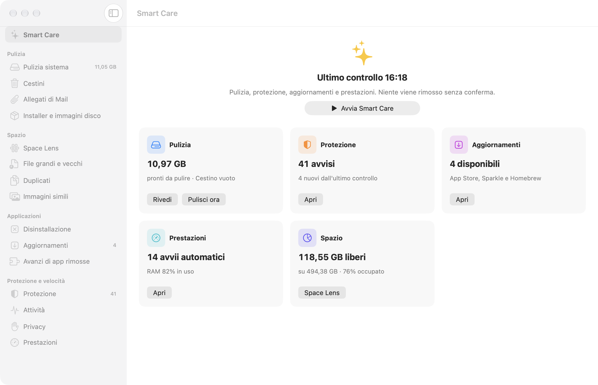
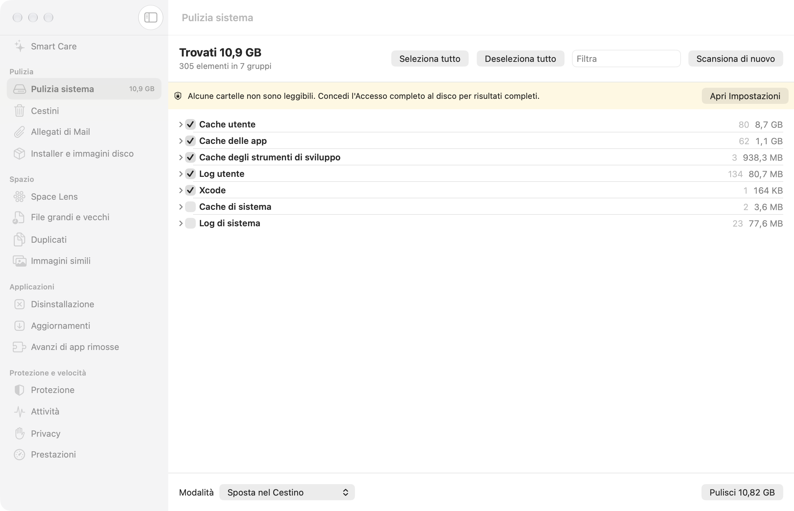

# MacCleaner

Un'app macOS indipendente e open source, scritta in Swift 6 e SwiftUI, che replica le funzioni di CleanMyMac 5: pulizia, spazio, applicazioni, protezione e velocità. Nessun abbonamento, nessuna telemetria, nessun demone sempre acceso: ogni operazione parte da un clic, viene mostrata prima di essere eseguita e finisce nel log.

> Sito di presentazione con screenshot: **https://nicomil.github.io/maccleaner/**





## In breve

| | |
|---|---|
| Piattaforma | macOS 14 o successivo, Apple Silicon e Intel |
| Linguaggio | Swift 6 (strict concurrency), SwiftUI, Swift Package Manager |
| Codice | 69 file Swift, circa 10.000 righe, 140 test automatici |
| Firma | ad-hoc con hardened runtime: non serve un account Apple Developer |
| Dipendenze esterne | solo libyara 4.5.4 (BSD-3), compilata nel pacchetto |
| Licenza | MIT |

## Funzioni

### Pulizia
- **Pulizia sistema**: cache utente e di sistema, cache delle app e degli strumenti di sviluppo, log, file di Xcode. Le cache delle app aperte sono escluse e il controllo è ripetuto subito prima della pulizia.
- **Cestini**: svuota il Cestino dell'utente e dei volumi esterni, compresi i file bloccati e gli elementi vuoti.
- **Allegati di Mail**: copie locali degli allegati che Mail può riscaricare.
- **Installer e immagini disco**: `.dmg` e `.pkg` già usati, riconosciuti dall'attributo di quarantena.

### Spazio
- **Space Lens**: mappa del disco cartella per cartella, con selezione multipla e rimozione diretta.
- **File grandi e vecchi**: soglia di dimensione configurabile, ordinati per età.
- **Duplicati** e **Immagini simili**: hash dei contenuti e confronto percettivo; resta sempre almeno una copia.

### Applicazioni
- **Disinstallazione**: bundle più Application Support, Containers, preferenze, cache, launch agent. Le app di proprietà di root vengono rimosse con la password tramite l'helper.
- **Aggiornamenti**: App Store, Sparkle e Homebrew in un'unica lista, che si aggiorna da sola quando una versione è stata installata.
- **Avanzi di app rimosse**: cartelle orfane che nessuna app, helper, processo o servizio launchd reclama più, con l'età dell'ultima modifica.

### Protezione e velocità
- **Protezione**: 14 controlli (elementi di login e launch agent, estensioni di sistema e kernel, estensioni e dirottamento dei browser, cron e shell, configurazione di rete, profili, TCC, certificati radice, XProtect, firme delle app, installazioni recenti, postura di sicurezza), più la scansione YARA con regole fornite dall'utente e una quarantena con ripristino.
- **Attività**: processi che consumano CPU, memoria, energia e rete.
- **Privacy**: cronologia, cookie e dati dei browser, elementi recenti, reti Wi-Fi ricordate, permessi delle app.
- **Prestazioni**: libera la RAM, elimina le istantanee locali di Time Machine, svuota la cache DNS, reindicizza Spotlight, ripara i permessi, velocizza Mail. Ogni scheda riporta cosa è cambiato davvero (per esempio "File in cache: 4,28 GB → 1,29 GB · liberati 2,99 GB").

### Trasversali
- **Smart Care**: una scansione che tocca pulizia, protezione, aggiornamenti e prestazioni, con riepilogo.
- Avanzamento di ogni operazione lunga in un banner comune a tutte le schermate: elementi e byte fatti sul totale, elemento in corso, tempo trascorso, fase (password, nuova scansione) e pulsante "Interrompi" che si ferma dopo l'elemento corrente.
- Monitor nella barra dei menu, scansioni pianificate, modalità predefinita (Cestino, eliminazione, prova), filtro e "seleziona tutto / deseleziona tutto" in ogni elenco.
- `mccli`: la stessa logica di scansione da Terminale, in sola lettura.

## Come è fatto

```
MacCleaner.app (SwiftUI)
 ├─ MacCleanerCore        regole, SafeRemover, PinnedFileSystem, log delle operazioni
 ├─ MacCleanerModules     un modulo per funzione (Apps/, Protection/, System/, …)
 ├─ CYara                 libyara compilata senza OpenSSL e senza scansione dei processi
 ├─ mchelper              unico eseguibile che tocca i file di sistema, lanciato come root
 └─ mccli                 scansioni da Terminale
```

- Ogni modulo implementa `CleanerModule`: produce un `ScanReport` di categorie e voci con dimensione, rischio e preselezione. L'interfaccia è la stessa per tutti.
- `SafeRemover` è l'unico punto che rimuove file. Accetta solo percorsi dentro le cartelle consentite, risolve i symlink prima del controllo, rifiuta i file protetti da SIP e registra tutto in `~/Library/Logs/MacCleaner/operations.log`.
- Le operazioni da amministratore sono un elenco chiuso (`AdminOperation`). Dopo la password, la shell di root copia `mchelper` in una cartella scrivibile solo da root, ne verifica lo SHA-256 e lo esegue. L'helper apre ogni cartella partendo da `/` senza seguire symlink e lavora relativamente al descrittore aperto (`PinnedFileSystem`), quindi uno scambio di cartelle mentre la finestra della password è aperta fa fallire l'operazione invece di spostarla altrove.
- Le specifiche funzionali in `docs/spec/` vengono da uno studio di CleanMyMac 5.7.2 (analisi statica con rea e Ghidra, cattura dinamica con `fs_usage`). Non contengono codice, testi o asset di MacPaw: le regole sono riscritte da zero sulla conoscenza pubblica di macOS.
- L'ultimo ciclo di lavoro è documentato con il metodo BMAD in `docs/bmad/` (brief, PRD, architettura, storie, QA).

## Build, test e installazione

Requisiti: Xcode (anche se `xcode-select` punta ai Command Line Tools) e XcodeGen (`brew install xcodegen`).

```bash
export DEVELOPER_DIR=/Applications/Xcode.app/Contents/Developer

# Test della logica: regole, rimozione sicura, moduli, helper
(cd Packages/MacCleanerKit && swift test)

# Progetto Xcode, build Release e installazione
xcodegen generate
xcodebuild -project MacCleaner.xcodeproj -scheme MacCleaner \
  -configuration Release -derivedDataPath build/DerivedData build
ditto build/DerivedData/Build/Products/Release/MacCleaner.app /Applications/MacCleaner.app

# Test dell'app (modelli di Disinstallazione, Space Lens, selezioni, filtri)
xcodebuild -project MacCleaner.xcodeproj -scheme MacCleaner \
  -derivedDataPath build/DerivedData -only-testing:MacCleanerTests test

# Scansioni da Terminale (sola lettura)
(cd Packages/MacCleanerKit && swift build -c release --product mccli)
Packages/MacCleanerKit/.build/release/mccli junk|trash|large|duplicates|similar|orphans|apps|updates|privacy|launch|mail|installers|malware|posture|processes|signatures
```

### Accesso completo al disco
Safari, i profili dei browser e i dati di molte app sono leggibili solo con l'Accesso completo al disco: Impostazioni di Sistema → Privacy e sicurezza → Accesso completo al disco → aggiungi MacCleaner. Con la firma ad-hoc macOS può dimenticare il permesso a ogni nuova build: se i risultati spariscono, toglilo e rimettilo.

## Sicurezza

Principi validi ovunque:
- Di default i file vanno nel **Cestino**. La modalità "Prova" non rimuove nulla. Le categorie a rischio alto non sono mai preselezionate.
- Niente viene rimosso senza una conferma che mostra elementi e dimensione totale.
- Ogni operazione, riuscita o rifiutata, è nel log delle operazioni.
- Tutto ciò che l'app legge da disco o da un comando (plist, manifest, script, output, regole YARA) è trattato come dato: parsato con limiti di dimensione, mai eseguito.

<details>
<summary>Dettagli per modulo</summary>

- **Cestini**: svuotare elimina per sempre (spostare nel Cestino ciò che è già nel Cestino non farebbe nulla), quindi le scelte sono "Svuota" e "Prova". I file bloccati (flag `uchg`) vengono sbloccati solo dentro le cartelle del Cestino e solo in questo modulo.
- **Disinstallazione**: i dati delle app non sono mai preselezionati, il bundle sì. Se il bundle appartiene a root viene rimosso con la password tramite `mchelper`, e un rifiuto per permessi viene ritentato una volta nello stesso modo. Durante la disinstallazione la lista è bloccata e i file da rimuovere sono fissati al momento della conferma.
- **Avanzi di app rimosse**: una cartella è elencata solo se nessuna app installata, helper, processo in esecuzione, app nota a Launch Services o servizio launchd la reclama. Entro 30 giorni dall'ultima modifica è a rischio alto. Niente è preselezionato.
- **Aggiornamenti**: l'elenco rilegge le versioni installate quando la schermata torna in primo piano e dopo ogni azione. Le voci dell'App Store che richiedono un macOS più recente e i cask Homebrew già aggiornati dall'app stessa non vengono mostrati.
- **Installer**: sono preselezionati solo `.dmg` non cifrati e `.pkg` di app già installate che macOS ha segnato come scaricati da internet. Immagini create dall'utente, `.sparseimage`, `.img` e `.iso` non sono mai preselezionati.
- **Pulizia sistema**: le cache di un'app aperta sono escluse, anche dentro il suo container o in cartelle come `<id>.ShipIt`.
- **Duplicati**: preselezionate solo le copie in Download; prima della pulizia il programma ricontrolla che la copia che resta esista ancora e sia identica.
- **Privacy**: prima di cancellare cronologia, cookie o password da un database di un browser ne viene salvata una copia completa nel Cestino, creata da SQLite (`VACUUM INTO`) e riletta prima di toccare l'originale. Se la copia non riesce, la pulizia non parte.
- **Elementi di avvio**: gli agenti vengono fermati nella sessione dell'utente, i servizi di sistema con la password. Il plist va nel Cestino solo dopo aver verificato che launchd non lo abbia più caricato.
- **Protezione**: la scansione standard non chiede mai la password. Il "Controllo approfondito" esegue una sola operazione privilegiata di sola lettura con un elenco fisso di comandi. L'origine di un'estensione Chromium viene dalle preferenze del profilo, non dall'`update_url` del manifest.
- **Quarantena**: i file sospetti vanno in `~/Library/Application Support/MacCleaner/Quarantine/<id>/` (o nella cartella di sistema equivalente tramite `mchelper`), con i permessi tolti e l'attributo di quarantena aggiunto. Ripristino ed eliminazione passano dalle stesse operazioni.
- **Regole YARA e liste di hash**: l'app non scarica nulla. L'utente aggiunge i file dalle Impostazioni, vede lo SHA-256 e un file che non compila viene rifiutato.
- **Nel Cestino** un elemento esistente non viene mai sostituito ("nome 2", "nome 3"…).

</details>

## Stato

| Milestone | Stato |
|---|---|
| Specifiche da CleanMyMac 5 (analisi statica e dinamica) | fatto |
| M1 core, pulizia sistema, cestini | fatto |
| M2 Space Lens, file grandi e vecchi, duplicati, immagini simili | fatto |
| M3 disinstallazione, avanzi, aggiornamenti | fatto |
| M4 privacy, prestazioni, operazioni da amministratore | fatto |
| M5 protezione, allegati di Mail, installer | fatto |
| M6 Smart Care, barra dei menu, scansioni pianificate, impostazioni | fatto |
| M7 protezione orientata alla sicurezza (14 controlli, YARA, quarantena) | fatto |
| Ciclo BMAD dopo il feedback d'uso (`docs/bmad/`) | fatto |

## Licenza

MacCleaner è progettato e sviluppato da Nicola Milella ed è distribuito con licenza [MIT](LICENSE). libyara è inclusa con la sua licenza BSD-3 (vedi `Packages/MacCleanerKit/Sources/CYara/LICENSE`).
